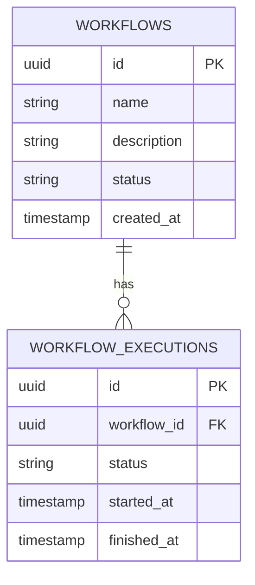

# AgentFlow AI — MVP v0.1.0

Plataforma de automação de workflows. **Esta versão ainda não executa agentes de IA**: implementa o núcleo de cadastro, criação de execuções e transições de estado. Spring AI, MCP, autenticação, auditoria e integrações AWS estão no roadmap.

## Stack
- Java 21, Spring Boot 3.5.6, Spring Data JPA, Flyway, PostgreSQL 17
- React 18, TypeScript, Vite, Nginx
- Docker Compose

## Executar
Pré-requisito: Docker Desktop com Compose.

```bash
docker compose up --build -d
docker compose ps
```

Acesse o dashboard: **http://localhost:3008**. API: **http://localhost:8088/api/v1/workflows**. Health: **http://localhost:8088/actuator/health**.

Para encerrar: `docker compose down`. Para apagar dados de desenvolvimento: `docker compose down -v`.

## Endpoints
| Método | Endpoint | Ação |
|---|---|---|
| GET | /api/v1/workflows | Listar workflows |
| POST | /api/v1/workflows | Criar workflow |
| POST | /api/v1/workflows/{id}/executions | Criar execução PENDING |
| GET | /api/v1/workflows/{id}/executions | Listar execuções |
| POST | /api/v1/workflows/executions/{id}/start | PENDING → RUNNING |
| POST | /api/v1/workflows/executions/{id}/complete | RUNNING → COMPLETED |

Exemplo:
```bash
curl -X POST http://localhost:8088/api/v1/workflows -H 'Content-Type: application/json' -d '{"name":"Aprovar pedido","description":"Fluxo de aprovação"}'
```

## Regras de negócio v0.1
1. Nome do workflow obrigatório e limitado a 120 caracteres; descrição até 1000.
2. Workflow criado com status ACTIVE.
3. Cada execução inicia em PENDING; transições válidas: PENDING → RUNNING → COMPLETED.
4. Transições inválidas retornam HTTP 409; recursos ausentes retornam 404.
5. Identificadores UUID; persistência PostgreSQL; schema versionado com Flyway.
6. **A versão inicial não executa tarefas externas nem agentes de IA**. O botão Executar cria um registro de execução, que deve ser iniciado e concluído manualmente.

## DER implementado


## Roadmap
- v0.2: usuários, autenticação JWT, autorização por perfil e auditoria
- v0.3: etapas de workflow, execução assíncrona e retry controlado
- v0.4: aprovação humana e filas de trabalho
- v0.5: Spring AI, ferramentas MCP com allowlist e controle de custos
- v0.6: observabilidade, métricas e rastreamento distribuído
- v0.7: AWS Bedrock / Step Functions com configuração opcional

## Segurança
As credenciais do Compose são **somente para desenvolvimento local**. Não publique a aplicação na internet antes de adicionar autenticação, autorização, segredos externos e controles de acesso.

## Testes
`cd backend && mvn test` (Java 21 + Maven necessários fora do Docker). O projeto inclui um teste unitário de transições; testes de integração ainda serão adicionados.
